# acp-llm-quiz

**阿里云 ACP 大模型认证 · 离线刷题器**

一个单文件网页：双击打开就能刷题，不需要联网、不需要安装、不需要微信。
内置 395 道题（273 单选 + 122 多选），每题都有答案和完整解析。

因为嫌小程序刷题体验太差（进度清不掉、点过「查看答案」就永久变背题模式），
自己重写了一个。所有数据存在浏览器本地，换电脑用「导出备份」带走。

```
📦 阿里云ACP大模型-离线题库.html    ← 就这一个文件，555 KB
```

---

## 目录

- [快速开始](#快速开始)
- [页面介绍](#页面介绍)
  - [练习区（5 个板块）](#练习区5-个板块)
  - [模拟考试](#模拟考试)
  - [数据区（4 个页面）](#数据区4-个页面)
  - [其他功能](#其他功能)
- [设计说明](#设计说明)
- [移动端](#移动端)
- [技术细节](#技术细节)

---

## 快速开始

1. 下载 `阿里云ACP大模型-离线题库.html`
2. **双击打开**（Chrome / Edge / Safari 都行）
3. 开始刷题

进度自动存在浏览器 localStorage 里，关掉再打开还在。

> **换电脑/重装系统前**：去「统计」页底部点「导出备份」，
> 会下载一个 JSON 文件。到新电脑上点「从备份恢复」导回来即可。
> 备份包含答题记录、错题本、掌握度、成绩走势、各板块进度。

---

## 页面介绍

### 练习区（5 个板块）

#### 1. 顺序刷题

按题库原顺序刷。**选项位置每轮随机打乱**，防止靠记「答案在第几个」蒙对。

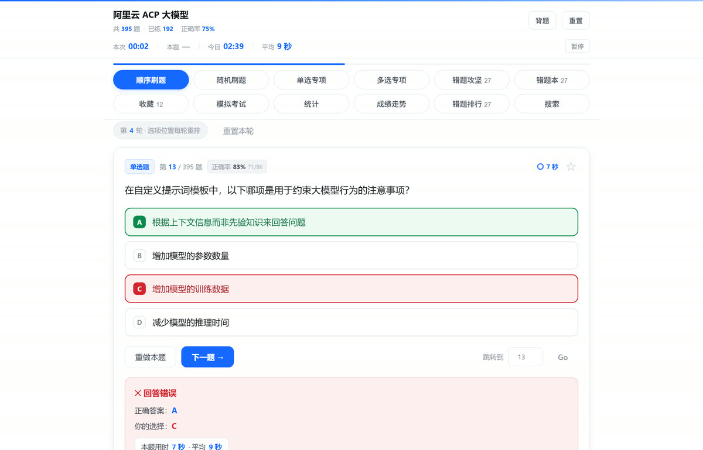

- 题号旁边显示**本板块正确率**（图中 83% · 71/86）
- 答完立刻给对错 + 解析 + 本题用时
- 顶部「第 N 轮」表示当前是第几轮（每次重置 +1，选项排列整体换一套）
- 右上角「重置本轮」只清这个板块的作答记录，不动其他板块

#### 2. 随机刷题

打乱题序，可开关「选项是否也打乱」。

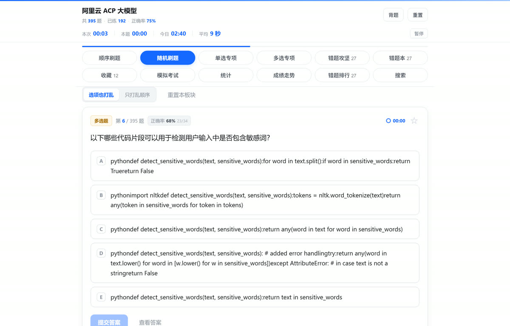

题目顺序一旦生成就固定保存，刷新浏览器不会变 —— 否则「翻页必翻丢」。

#### 3. 单选专项

只练 273 道单选题，集中刷一种题型。

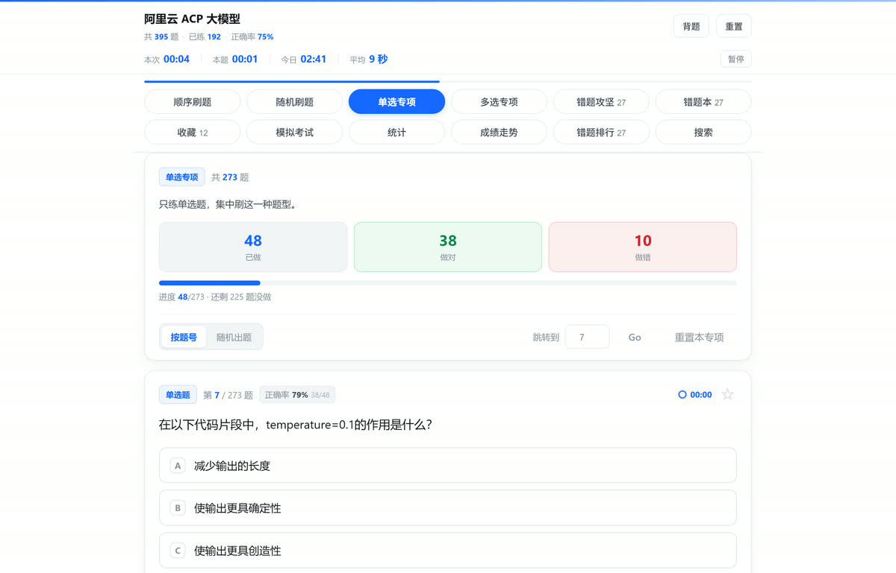

带概览卡：**已做 / 做对 / 做错**三个大数字 + 进度条。
支持「按题号 / 随机出题」切换、跳转到第 N 题、独立重置。

#### 4. 多选专项

只练 122 道多选题。多选是提分重点 —— **漏选、多选都算错**。

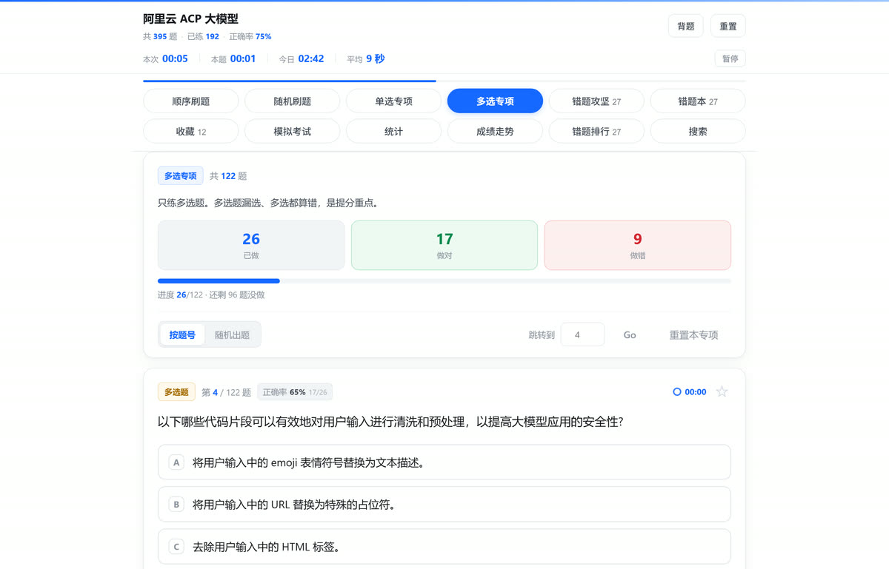

#### 5. 错题攻坚

只练「做错过、且还没真正掌握」的题。**连续答对 3 次自动移出**，池子会越刷越小。

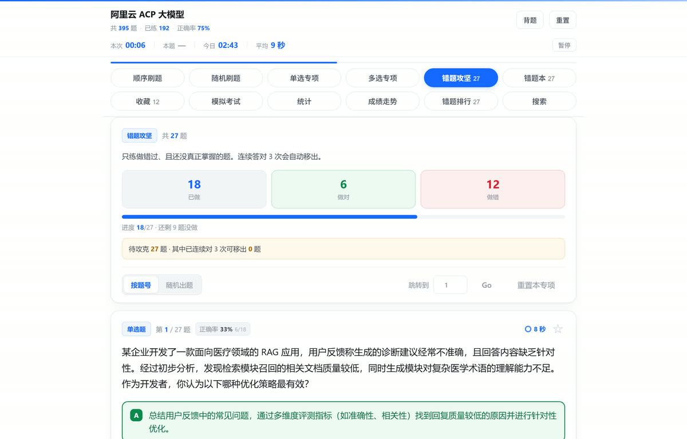

- 顶部显示「待攻克 N 题 · 其中已连续对 3 次可移出 M 题」
- 三档等级：顽固（错过且当前连续对为 0）/ 巩固中（对 1~2 次）/ 已掌握（对满 3 次）

> 为什么不是「答对一次就移出」：选择题 4 选 1，蒙对概率 25%。
> 错过的题第二次答对**很可能只是蒙对**，按旧逻辑题就从错题本消失了，下次考试照样错。
> 这叫「假掌握」。要求连续 3 次、且答错即归零，才挡得住蒙对。

#### 错题本 & 收藏

错题本自动收集答错的题；收藏手动星标。

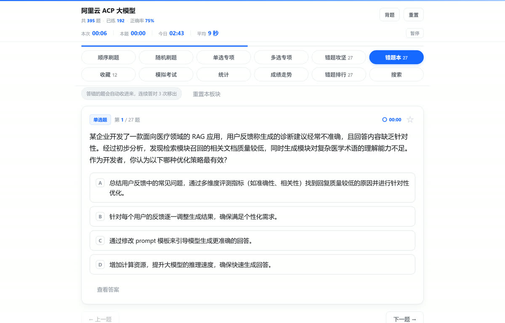

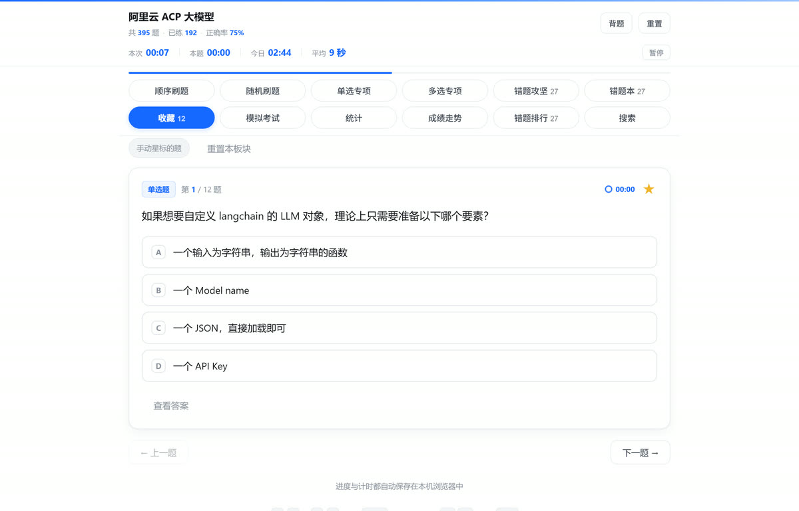

两者都是**全站汇总**：不管在哪个板块答错的，都进同一个错题本。
但你在错题本里重做时，记录只写进错题本自己的进度，**不会改掉顺序刷题的进度**。

---

### 模拟考试

按真实考试规格出卷：**50 单选×1分 + 25 多选×2分 = 100 分，限时 120 分钟，80 分及格**。
每次从题库随机抽题，卷子都不一样。

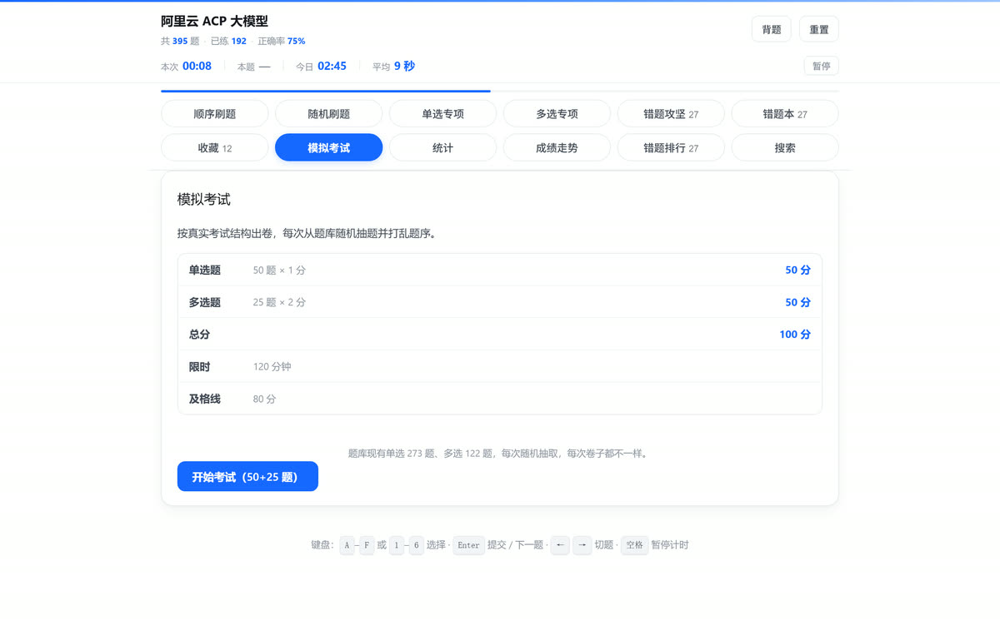

#### 考试中：只看得到时间，看不到对错

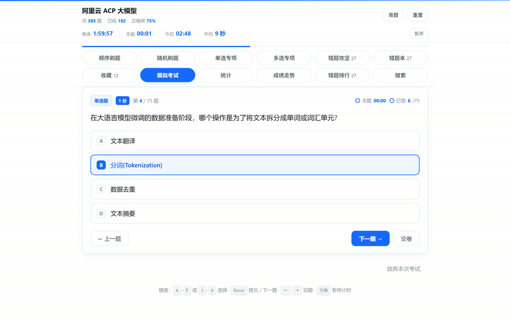

题卡上只有：题型、本题分值、题号、本题计时、已答 `6/75`。
**没有任何得分、正确率、对错提示**。

> 这里踩过一个坑：原来题卡右上角有个「约 X 分」实时估分。
> 看着只是个参考数字，其实它在**当场判卷** ——
> 答错分数不动、改成对的立刻 +1。每答完一题瞄一眼就知道该不该改答案，
> 模拟考试直接退化成「边考边对答案」。已移除。
>
> 考试和练习的反馈节奏本来就该相反：练习要即时反馈（那是学习），
> 考试要延迟反馈（那是摸底）。

#### 交卷后：成绩单

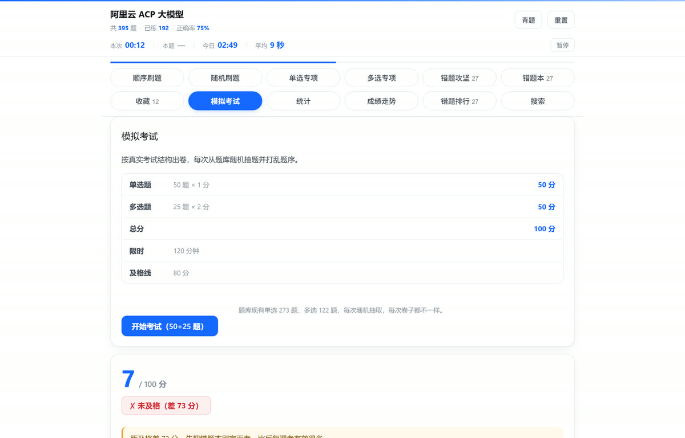

总分、及格判定（差几分）、针对性批注、正确率 / 答对 / 答错 / 用时 / 平均每题、
**单选与多选分项得分**、逐题解析入口、历史成绩柱状图。

#### 逐题解析

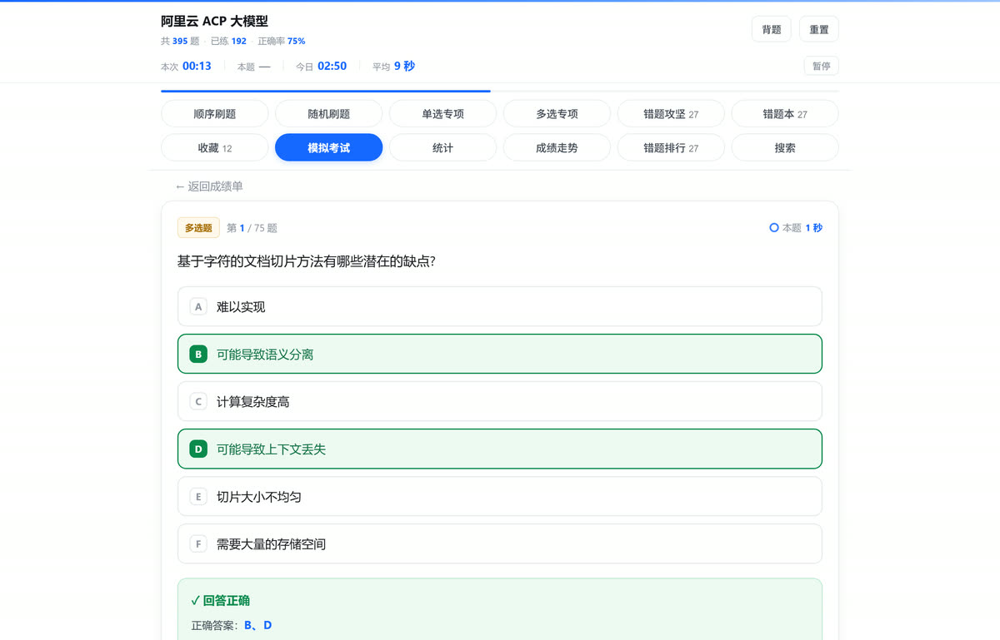

点任一题看详细解析，这时才给「✓ 回答正确」和正确答案。

---

### 数据区（4 个页面）

#### 统计

按题型 / 按难度看整体学习情况。

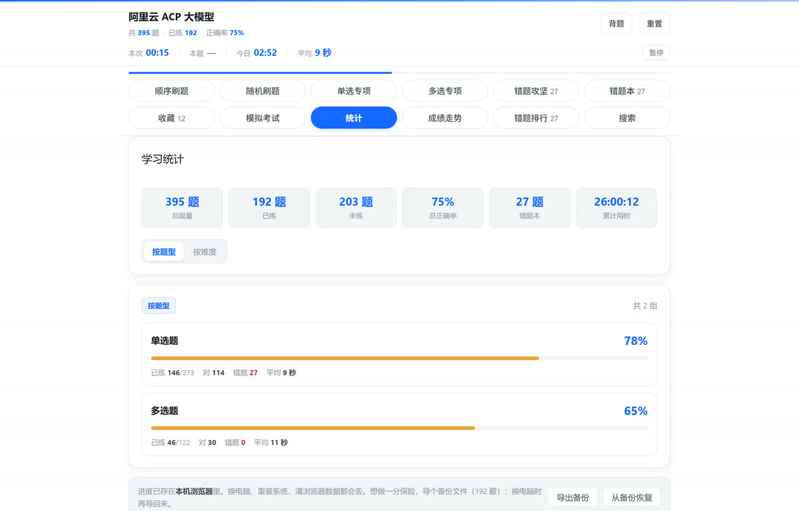

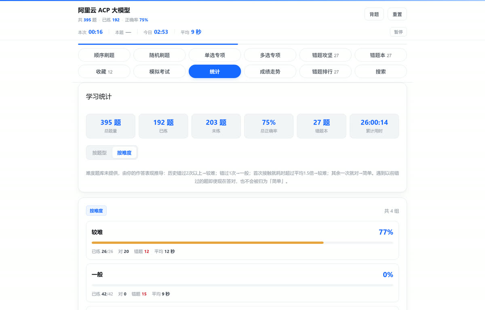

> **难度不是题库提供的**，而是根据你的作答表现推导的：
> 历史错过 ≥2 次 → 较难；错过 1 次 → 一般；首次接触耗时超过平均 1.5 倍 → 较难；
> 其余一次就对 → 简单。
>
> 关键设计：**先看历史错次，再看本次对错**。
> 这样「以前错过、今天答对了」的题不会被洗成「简单」——
> 否则统计就失去意义了。

#### 成绩走势

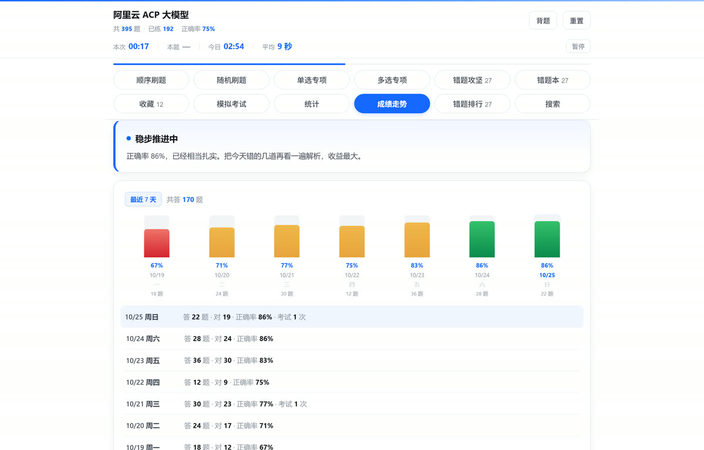

- **今天的鼓励语** —— 按当天正确率分档，文案随数据变化
- **最近 7 天正确率柱状图** —— 颜色分档（≥85% 绿 / ≥70% 橙 / <70% 红）
- **7 天明细** —— 每天答多少、对多少、正确率、考试次数
- **趋势批注** —— 比较首尾两天，给出「上升/回落/稳定」和具体百分点
- **考试历史柱状图** —— 最近 15 次得分，虚线为及格线

#### 错题排行

按**累计答错次数**降序，找出反复错的顽固题。


错次**只增不减**（答对也不减），否则就看不出哪些题在反复错。
点条目可跳回那道题。

#### 搜索

题干、选项、解析全文搜索。

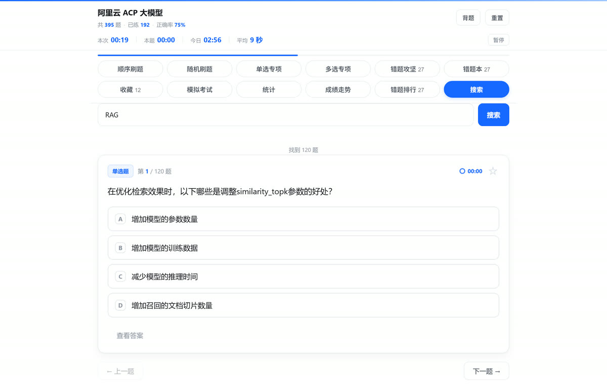

---

### 其他功能

#### 查看答案（只影响当前这一题）

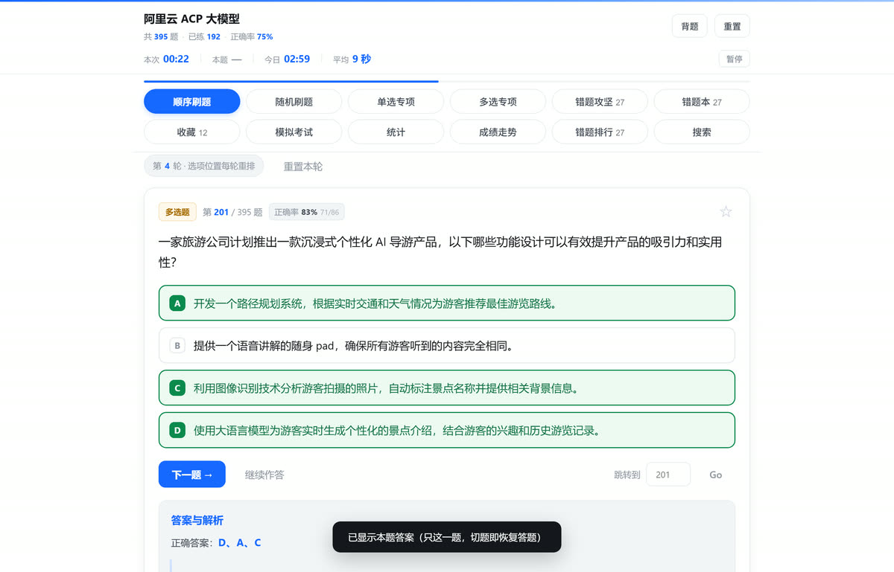

点「查看答案」只揭示**当前这一题**，切题即恢复答题、刷新即失效。
不影响其他题、不开启全局背题模式、不写进存档。

> 原来点一次会把全局「背题模式」永久打开并持久化 ——
> 于是点过一次之后所有板块都变成只看答案不能作答，下次打开还是这样。
> 用户感受就是「怎么默认不让我刷题了」。

#### 备份 / 恢复

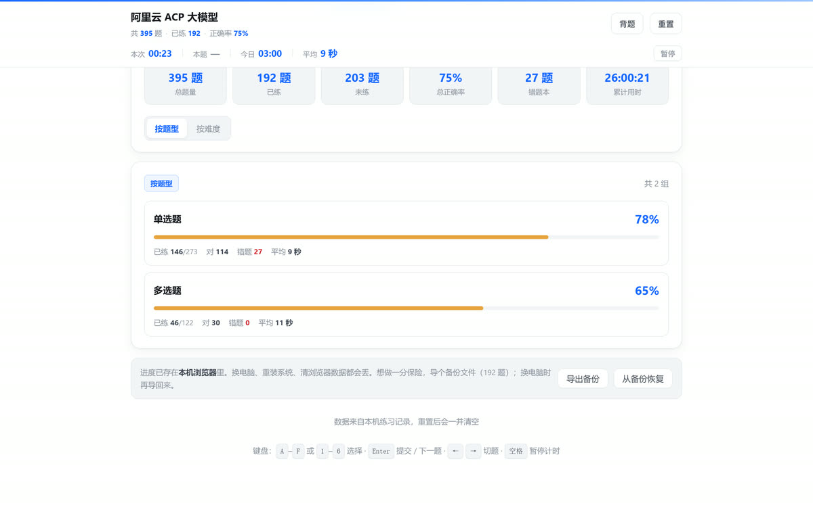

导出 JSON 文件，换电脑或数据被清时导回来。
备份格式有版本号（当前 v3），旧备份仍可导入。

#### 键盘操作

| 按键 | 作用 |
|---|---|
| `A`–`F` / `1`–`6` | 选择选项 |
| `Enter` | 提交 / 下一题 |
| `←` `→` | 上一题 / 下一题 |
| `空格` | 暂停 / 继续计时 |

> 选项打乱后，按键映射会跟着换算 —— 按 `A` 选中的永远是**屏幕上显示为 A 的那一行**。

---

## 设计说明

### 板块隔离：各刷各的，但该汇总的汇总

九个板块共用一份作答记录会互相点亮（顺序刷题答过的题，到单选专项里也显示「已作答」）。
所以**作答记录按板块分开存**，但**汇总类数据全站共享**：

| 按板块独立 | 全站汇总 |
|---|---|
| 作答记录（对错、选了啥、用时） | 错题本、收藏名单 |
| 题卡正确率徽标 | 累计错次、掌握度 |
| 专项概览卡数字 | 成绩走势、考试历史 |
| 刷到第几题、随机题序 | 顶栏「已练 N 题」、统计页 |

一句话：**隔离的是「进度」，共享的是「事实」**。

### 模拟考试完全独立

考试作答存在自己的地方，**不写进任何练习板块**。
考完一场试，顺序刷题/专项板块的记录一条都不会变。

但**答错的题会进错题本**（方便考完专项攻克），
而**没作答的题不算错** —— 交白卷不会往错题本塞 75 道「错题」。

### 进度会不会丢

| 场景 | 结果 |
|---|---|
| 正常关闭浏览器 / 关机重启 | ✅ 保留 |
| 强杀进程但已过几秒 | ✅ 保留 |
| 答题后瞬间断电 | ⚠️ 最后一题可能丢 |
| 换目录、改文件名 | ✅ 保留（`file://` 按源共享存储） |
| 换浏览器 | ➖ 各自独立 |
| 无痕/隐私模式 | ⚠️ 关掉即丢 |
| 清浏览器站点数据 | ⚠️ 会丢 |
| 换电脑 / 重装系统 | ⚠️ 会丢，用备份 |

加固措施：每 5 秒自动落盘、切后台立刻存、`pagehide` + `beforeunload` 双保险。

容量实测：395 题全做完 + 全收藏 + 全错次记录 ≈ 110 KB，
浏览器 localStorage 可存 5 MB 以上，余量约 46 倍。

---

## 移动端

响应式布局，手机浏览器可直接打开。

| 顺序刷题 | 专项练习 |
|---|---|
| 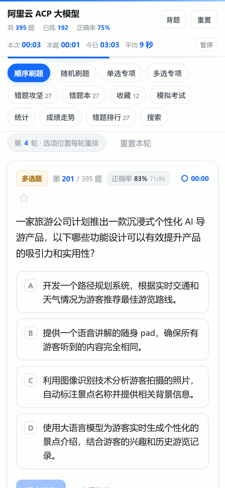 | 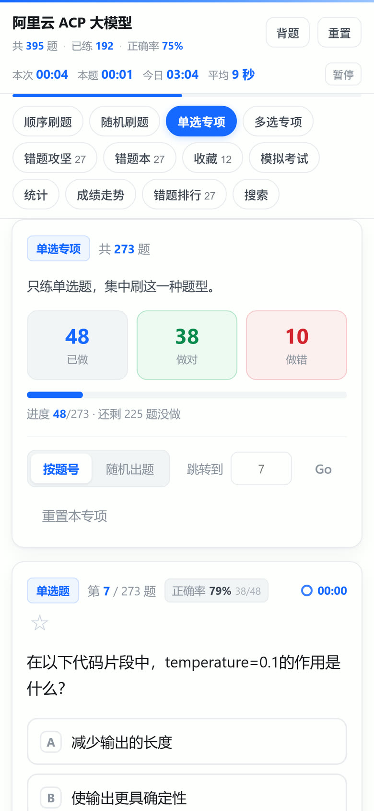 |

- **12 个标签**在宽屏排成 6 列×2 行，手机自动换行（实测 3 行）
- 吸顶区只保留品牌 + 计时（98px），标签栏会跟着页面滚走，
  避免手机上吸顶区吃掉 1/3 屏
- 窄屏（≤380px）再缩一档，隐藏数字徽标

---

## 技术细节

### 题库来源

题库通过小程序后端接口下发（非打包在 `wxapkg` 里），
题目内容 AES-128-CBC 加密，密钥从响应里的 `CreationTime` 推导。

导出脚本在 `work/` 里，题库更新时改 Qbid 重新导一份即可。

### 数据完整性

`build.js` 在生成 HTML 前会自检，任一项不过就中止、不产出坏题库：

- 题干为空、选项少于 2 个、没有正确答案
- 单选题多答案、多选题少答案、缺解析

### 已知的题库数据问题

原始数据里有 **7 道多选题所有选项都被标记为正确答案**
（接口返回的 `IsAnswer` 全为 true，不是导出时算错的）。

这类题在练习时唯一正确形态是「必须全选」，漏一个就错。
页面上已加说明，避免用户反复纠结。

### 测试

`verify/` 里有 16 套自动化测试，共 **764 项**，
覆盖单元逻辑、端到端点击路径、边界情况、真实浏览器渲染。

```bash
cd work
node verify/verify_ui_timer.js      # 版面 + 计时 + 功能回归
node verify/verify_board_isolation.js  # 板块隔离
node verify/verify_keyboard.js      # 键盘映射
node verify/verify_reset_scope.js   # 重置作用域
# 其余 13 套同理
```

---

## License

个人自用项目。题库内容版权归原题库提供方所有，此仓库仅包含刷题工具。
